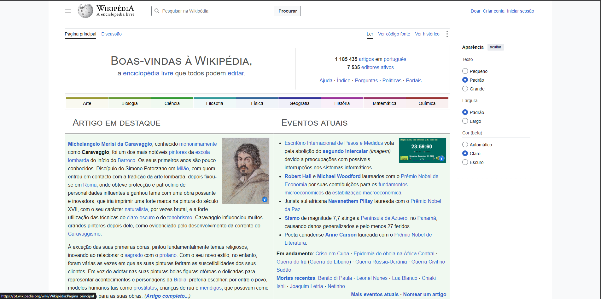

# Automação de Testes — Wikipédia

## Descrição do Projeto

Este projeto tem como objetivo desenvolver testes automatizados para a Wikipédia em português, utilizando o Playwright com TypeScript.

A Wikipédia é uma enciclopédia online gratuita e colaborativa, que permite aos usuários pesquisar informações, acessar artigos e navegar entre diferentes conteúdos.

A automação foi desenvolvida para verificar o funcionamento de funcionalidades importantes do site, identificar possíveis falhas e validar os comportamentos esperados durante a navegação.

## Objetivos dos Testes

Os principais objetivos deste projeto são:

Verificar se a página inicial abre corretamente.

Validar o título da página no navegador.

Verificar a visibilidade do campo de pesquisa.

Testar a pesquisa e a abertura de artigos.

Validar a navegação por links.

Verificar a exibição de prévias ao passar o mouse sobre links.

Testar o acesso direto a artigos por URL.

Validar a mensagem exibida quando uma pesquisa não retorna resultados.

Verificar o acesso a artigos aleatórios.

Testar a troca de idioma da página.

## Cenários de teste

Foram definidos os seguintes cenários:

Verificar se a página inicial abre.

Verificar o título do navegador.

Verificar se o campo de pesquisa está visível.

Pesquisar um artigo e validar o resultado.

Clicar em um link para outro artigo.

Passar o mouse sobre um link e verificar a prévia.

Abrir o artigo Pernambuco diretamente pela URL.

Verificar a mensagem de pesquisa sem resultados.

Verificar se o acesso aleatório apresenta artigos diferentes.

Trocar o idioma e verificar a alteração da URL.

## Tecnologias utilizadas

Playwright: ferramenta utilizada para a automação dos testes de navegador.

TypeScript: linguagem utilizada para escrever os testes.

Node.js e npm: ambiente e gerenciador de pacotes utilizados para executar o projeto e instalar dependências.

Visual Studio Code: editor utilizado no desenvolvimento.

Git e GitHub: ferramentas utilizadas para versionamento e compartilhamento do código.

## Como executar os testes

### Pré-requisitos

É necessário ter o Node.js e o npm instalados no computador.

### Instalação das dependências

No terminal, dentro da pasta do projeto, execute:

npm install

Executar os testes

Para executar todos os testes do projeto:

npx playwright test

Para executar somente os testes da Wikipédia, caso o arquivo esteja em tests/wikipedia.spec.ts:

npx playwright test tests/wikipedia.spec.ts

Visualizar o relatório

Após a execução, para abrir o relatório HTML do Playwright:

npx playwright show-report